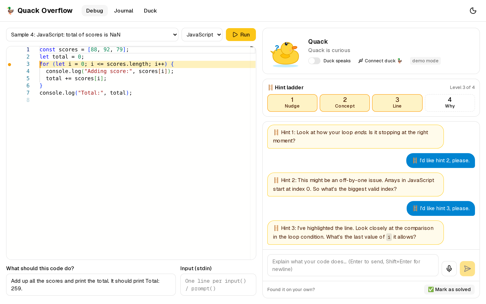
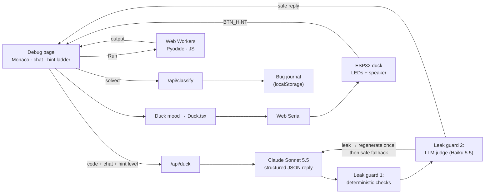

# 🦆 Quack Overflow

> **The AI rubber duck that refuses to give you the answer.**

Built for **Next Byte Hacks V5**.



**Live demo:** _coming soon (Vercel link goes here after deploy)_

---

## The problem

Beginners paste an error into an AI tool, copy the fix, and learn nothing. Next week the same bug shows up and they're stuck again.

*Rubber duck debugging* (explaining your code out loud to a duck until you spot the bug yourself) really works. But a real duck can't ask follow-up questions.

## The solution

Quack Overflow is a web app with an animated duck, **Quack**, plus an optional physical duck. You paste your code and explain the bug by typing or talking. Quack **only asks Socratic questions** that guide you to the bug. It never writes the fix. When you find the bug yourself, Quack celebrates (and the hardware duck quacks and flashes rainbow).

## Features

- **🗨️ Duck chat:** a question-only conversation about your code. Quack makes you predict, trace, and compare.
- **🛡️ Leak guard:** every reply is checked before you see it, deterministically and by an AI judge. Leaky drafts are regenerated, or replaced with a safe question.
- **🪜 Hint ladder:** 4 levels: nudge → concept → highlight the exact line in the editor → explain *why* it's wrong. Still never the fix.
- **▶️ Run code in the browser:** Python (Pyodide) and JavaScript run in sandboxed Web Workers with a 5 s infinite-loop guard and stdin support. Output lands in the chat and Quack asks you to interpret it.
- **📓 Bug journal:** each solved bug is classified (off-by-one, wrong type, …) with a one-line lesson. Stats, a category chart, and patterns like *"You've had 3 off-by-one errors this week 👀"*.
- **🎙️ Voice mode:** talk to the duck (speech-to-text), and it talks back in a suitably high-pitched voice.
- **🦆 Hardware duck (optional):** an ESP32 rubber duck with LEDs and a speaker, controlled from the browser over USB (Web Serial). Its button requests the next hint.
- **🧪 Demo mode:** `MOCK_AI=true` runs the whole app with scripted conversations and no API key.
- Dark mode, reduced-motion support, keyboard-friendly, Lighthouse accessibility **100**.

## Architecture



**How the leak guard works** (`lib/leakGuard.ts`, `lib/guardPipeline.ts`):

1. **Deterministic checks** (no LLM, unit-tested with 22 fixture replies):
   - Code blocks and inline code must be verbatim quotes of *your* code or program output. Single names, numbers and operators (`i`, `undefined`, `<=`) are allowed.
   - **Near-copy detection:** a Smith–Waterman token alignment between every reply line and every code line flags "edited copies" of real lines, e.g. `range(len(nums))` vs your `range(1, len(nums))`, even without backticks.
   - Known fixes for the sample programs.
   - Red-flag phrases ("change X to Y", "replace … with …") escalate to the judge.
2. **LLM judge:** a fast Claude Haiku 5.5 call returns `{leak, reason}`. It fails closed.
3. **Regenerate once** with the reason; if it still leaks, fall back to a safe generic question.
4. Guard catches are counted (server log + "Answer leaks blocked" in the journal).

The duck API streams progress (`thinking → checking → rewriting`) as NDJSON, but **never streams raw model tokens**, because the guard has to see the whole reply before you do.

## Setup

### Prerequisites

- Node.js **20+** (developed on Node 24) and npm
- Chrome or Edge for voice and the hardware duck (everything else works in any modern browser)
- An [Anthropic API key](https://console.anthropic.com/) for real AI replies (optional: demo mode needs none)

### Run it

```bash
git clone https://github.com/JasperRosales/quack-overflow.git
cd quack-overflow
npm install
cp .env.example .env.local     # then edit .env.local
npm run dev                    # http://localhost:3000
```

`.env.local`:

```bash
ANTHROPIC_API_KEY=sk-ant-...      # your key
ANTHROPIC_MODEL=claude-sonnet-5-5 # duck model
MOCK_AI=false                     # true = scripted replies, no API calls
# Optional: ANTHROPIC_GUARD_MODEL / ANTHROPIC_CLASSIFY_MODEL (default claude-haiku-5-5)
```

### Demo mode (no API key)

Set `MOCK_AI=true`, or leave `ANTHROPIC_API_KEY` empty: the app falls back to mock mode automatically and shows a "demo mode" badge. All six samples have scripted conversations. Samples 1 (Python average) and 4 (JS `<=` loop) have the full arc: questions → hints → line highlight → solved. Mock replies still pass through the deterministic leak guard.

### Scripts

| Command | What it does |
|---|---|
| `npm run dev` / `build` / `start` | Next.js dev server / production build / serve |
| `npm test` | Vitest unit tests (leak guard fixtures, guard pipeline, mock duck, journal stats, tracebacks) |
| `npm run test:e2e` | Playwright smoke test (starts its own mock-mode dev server) |
| `npm run redteam -- --base http://localhost:3000` | Sends 15 "just tell me the answer" attacks and counts leaks |
| `npm run screenshots -- --base http://localhost:3000` | Saves the 4 Devpost screenshots to `deliverables/screenshots/` (add `--dark` for dark mode) |
| `npm run typecheck` / `lint` | TypeScript / ESLint |

### Flash the hardware duck (optional)

Full parts list, pin table and wiring diagram: **[hardware/wiring.md](hardware/wiring.md)**. In short:

1. Arduino IDE 2 → *Boards Manager* → install **esp32 by Espressif (3.x)**; *Library Manager* → **Adafruit NeoPixel**.
2. Open `hardware/duck_firmware/duck_firmware.ino`. Set `USE_I2S 1` if you use the MAX98357A amp (default `0` = passive buzzer).
3. Select your board and port, then **Upload**. Close the Serial Monitor afterwards.
4. In Chrome, open `/duck` → **Connect duck 🦆** → try the test buttons.

## Tech stack

Next.js 16 (App Router, Turbopack) · TypeScript · Tailwind CSS v4 · shadcn/ui (Base UI) · Monaco Editor · Framer Motion · Recharts · Anthropic SDK (Claude Sonnet 5.5 + Haiku 5.5, structured outputs) · zod · Pyodide · Web Workers · Web Speech API · Web Serial API · ESP32 / Arduino · Vitest · Playwright · Vercel

## Testing status

| Check | Result |
|---|---|
| Unit tests (`npm test`) | 47 passing |
| Playwright smoke test | sample 4 → run → chat → hint 3 highlights line 3 → mark solved → journal updated ✅ |
| All 6 samples run in the browser, infinite loops stop after 5 s | ✅ |
| Lighthouse (production build) | Accessibility 100 on all pages · Best practices 100 |
| Red-team, mock mode | 0 / 15 leaks |
| Red-team, live AI | _not yet run: needs an API key (`npm run redteam`)_ |
| Hardware duck | Web Serial path tested with a simulated port; firmware not yet flashed to a real board |

## Limitations

- Supports only Python and JavaScript for now.
- Bug classification is AI-generated and may be imperfect.
- Web Serial (hardware duck) and the best voice support only work in Chromium browsers (Chrome/Edge).
- The leak guard greatly reduces answer leaks but can't guarantee zero.
- A Python program that times out restarts the Pyodide worker, so the next run warms up again (a few seconds).
- The journal lives in your browser's localStorage (no accounts, no sync).

## What's next

- A VS Code extension, so the duck lives in your editor.
- A classroom mode where teachers see anonymized class-wide bug patterns.
- More languages (Java, C++), using server-side sandboxed execution.
- Duck personalities: Pirate Duck, Professor Duck, Gen-Z Duck.
- A Wi-Fi duck (no USB cable) and a cheaper 3D-printed duck kit.

## Team

- **Jasper Rosales** ([@JasperRosales](https://github.com/JasperRosales))

## License

[MIT](LICENSE)
