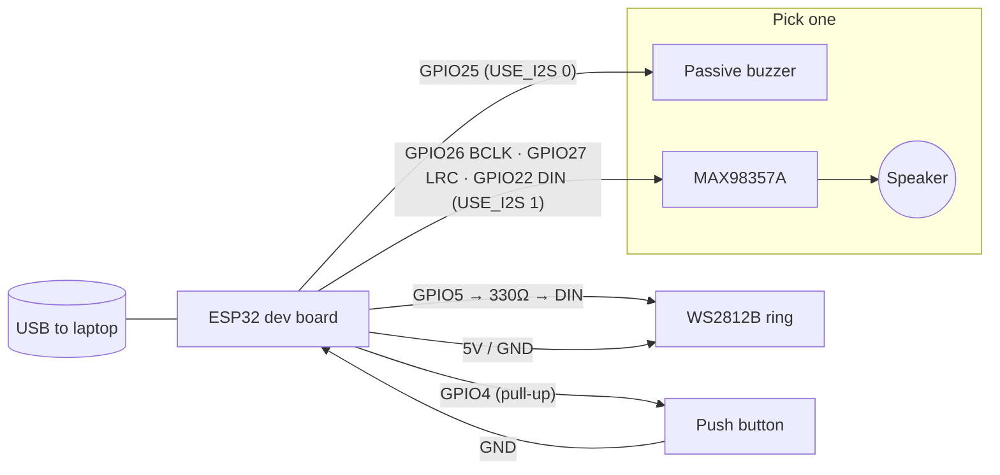

# Hardware duck — parts & wiring

The hardware duck is **optional**. It mirrors Quack's mood with LEDs and sound, and its button
requests the next hint. The web app works the same with or without it.

## Parts (about ₱800–1,500)

| Part | Notes |
|---|---|
| ESP32 dev board (DevKitC / WROOM-32) or Arduino Nano ESP32 | Any ESP32 with USB serial |
| WS2812B LED ring or strip, 3–8 LEDs | 5 V, data at 3.3 V logic works for short runs |
| **Sound, option A:** MAX98357A I2S amp + small 3 W 4–8 Ω speaker | Louder, nicer quack |
| **Sound, option B (budget):** passive piezo buzzer | Set `USE_I2S 0` (default) |
| Push button (optional) | The "I'm stuck" hint button |
| 330 Ω resistor (LED data), 470–1000 µF capacitor (LED power) | Recommended for LED strips |
| Large rubber duck, hollowed out underneath | Hot glue is your friend |
| USB cable | Power + data |

## Pin table

| ESP32 pin | Goes to | Notes |
|---|---|---|
| `GPIO 5` | WS2812B **DIN** | through a 330 Ω resistor |
| `5V` / `VIN` | WS2812B **5V**, MAX98357A **VIN** | USB 5 V |
| `GND` | WS2812B **GND**, MAX98357A **GND**, buzzer **−**, button | common ground |
| `GPIO 4` | Push button (other leg → GND) | internal pull-up, sends `BTN_HINT` |
| `GPIO 25` | Passive buzzer **+** | only with `USE_I2S 0` |
| `GPIO 26` | MAX98357A **BCLK** | only with `USE_I2S 1` |
| `GPIO 27` | MAX98357A **LRC** (WS) | only with `USE_I2S 1` |
| `GPIO 22` | MAX98357A **DIN** | only with `USE_I2S 1` |
| — | MAX98357A **SD** | leave unconnected (on), **GAIN** unconnected = 9 dB |

Pins are `#define`s at the top of `duck_firmware/duck_firmware.ino`, so change them freely.

## Wiring diagram



ASCII version:

```
                 +-------------------+
   USB  ======== |       ESP32       |
                 |                   |
   WS2812B DIN <-[330Ω]-- GPIO5      |
   WS2812B 5V  <--------- 5V/VIN ----+--> MAX98357A VIN
   WS2812B GND <--------- GND -------+--> MAX98357A GND, buzzer -, button
                 |                   |
   Button ------------->  GPIO4      |      (button other leg -> GND)
   Buzzer + <-----------  GPIO25     |      (USE_I2S 0)
   MAX98357A BCLK <-----  GPIO26     |      (USE_I2S 1)
   MAX98357A LRC  <-----  GPIO27     |
   MAX98357A DIN  <-----  GPIO22     |
                 +-------------------+          MAX98357A OUT+/- -> speaker
```

## Flashing the firmware (Arduino IDE 2.x)

1. Install the **ESP32 board package**: *File → Preferences → Additional boards manager URLs*, add
   `https://espressif.github.io/arduino-esp32/package_esp32_index.json`, then *Tools → Board → Boards Manager*,
   search **esp32** (by Espressif), install **3.x**.
2. Install the **Adafruit NeoPixel** library: *Tools → Manage Libraries…*, search "Adafruit NeoPixel".
3. Open `hardware/duck_firmware/duck_firmware.ino`. If you use the MAX98357A, change `#define USE_I2S 0` to `1`.
4. *Tools → Board* → your board (e.g. **ESP32 Dev Module**), *Tools → Port* → the duck's USB port.
5. Click **Upload**. (Some boards need the **BOOT** button held when "Connecting…" appears.)
6. Open *Tools → Serial Monitor* at **115200** baud. You should hear a quack and see `READY`.
   Type `PARTY` and press Enter to test. **Close the Serial Monitor** before connecting from the browser:
   only one program can use the port at a time.

## Connecting from the app

1. Use desktop **Chrome or Edge** (Web Serial).
2. Open `/duck`, click **Connect duck 🦆**, pick the ESP32 port.
3. Use the test buttons to check every state, then press the physical button: the serial log shows `BTN_HINT`.
4. On `/debug`, the duck now follows Quack's mood, quacks on each reply, parties when you solve the bug,
   and the button climbs the hint ladder.

## Behavior

| Command | LEDs | Sound |
|---|---|---|
| `IDLE` | soft yellow breathing | – |
| `THINK` | spinning blue | – |
| `CURIOUS` | blinking yellow | short "quack?" |
| `QUACK` | white flash, then back to previous state | quack |
| `PARTY` | rainbow chase, 3 s | triple quack + fanfare |
| `SLEEP` | dim | – |
| `PING` | – | replies `READY` |

## Troubleshooting

- **No port in the picker:** try another cable (many are charge-only) or install the CP210x/CH340 USB driver.
- **"Failed to open serial port":** close the Arduino Serial Monitor.
- **LEDs flicker or show random colors:** add the 330 Ω resistor and the capacitor, and share GND.
- **Buzzer is silent:** it must be a *passive* buzzer (active buzzers only beep at one pitch).
